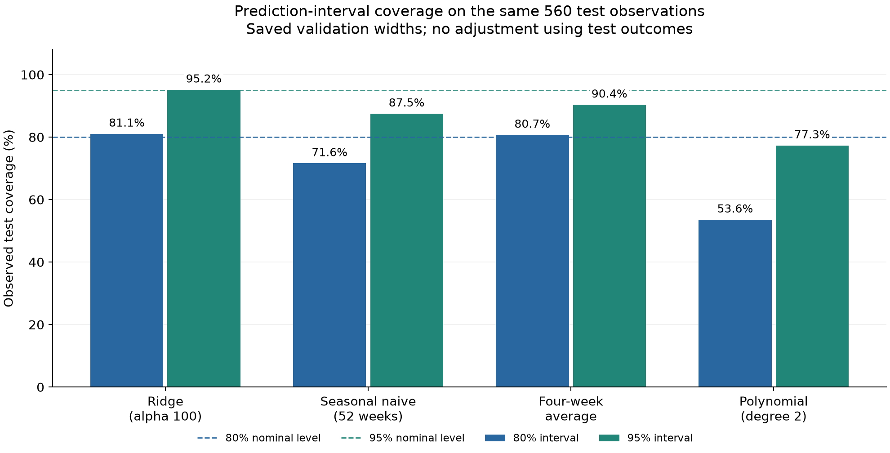
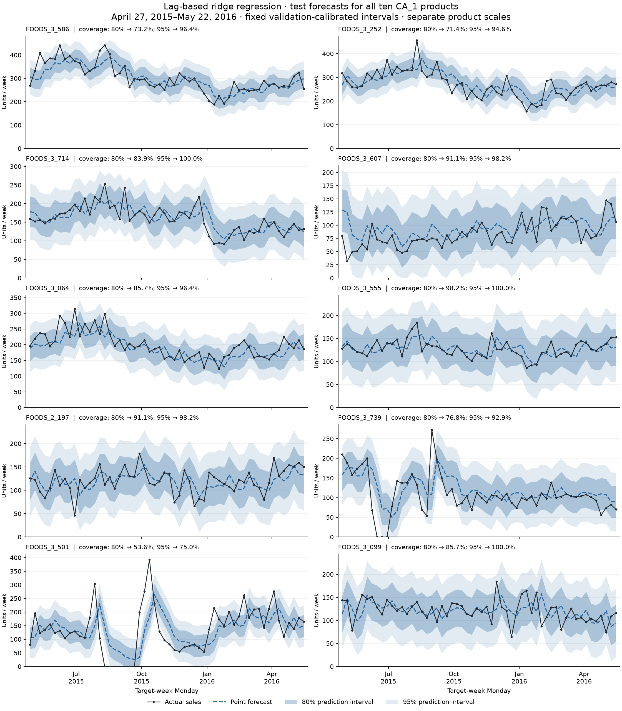
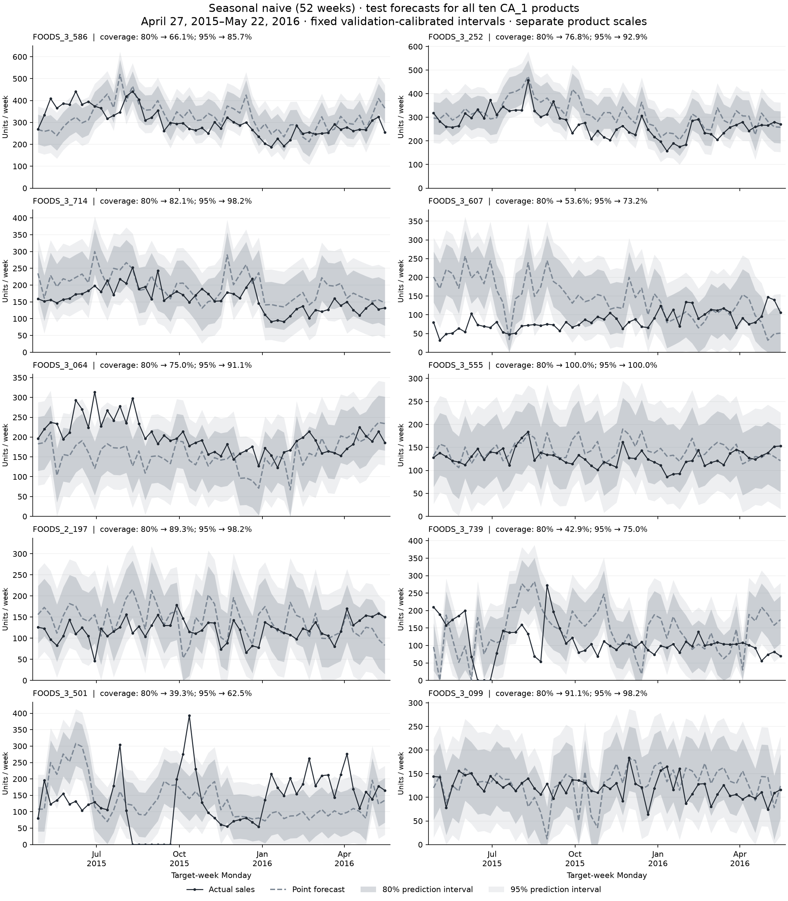
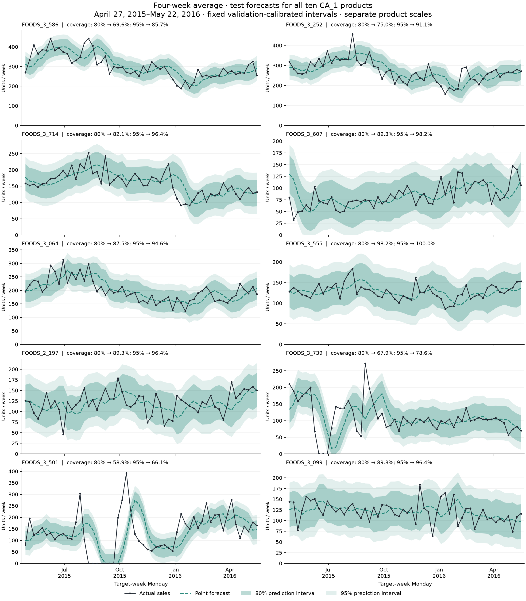
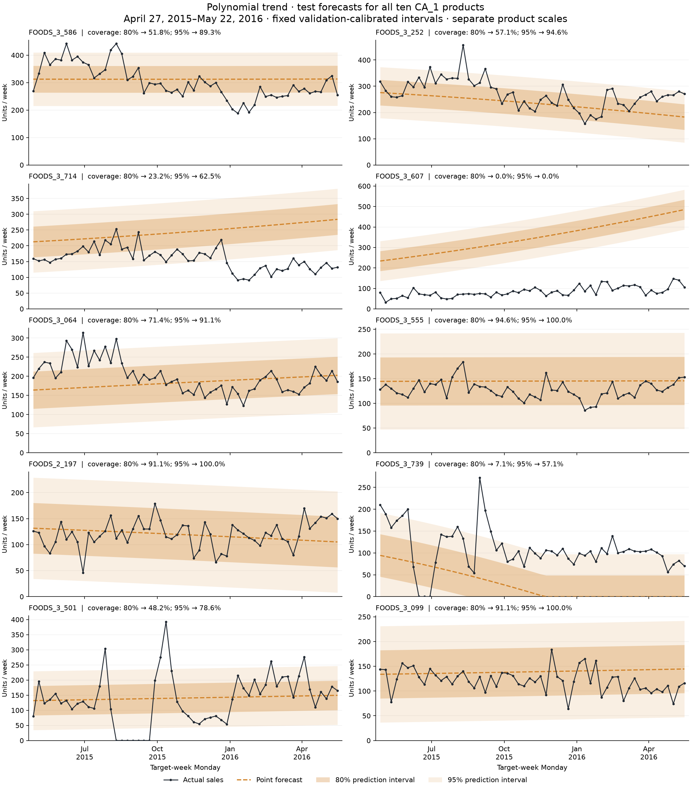

# Part 5 — Add uncertainty and plots

This completes the five technical sections of the Milestone 2 notebook. Four fixed models each have **80% and 95% prediction intervals** for the same **560 test product-weeks**, giving **4,480 intervals**. Test dates remain **April 27, 2015–May 22, 2016**. Ridge remains the model selected on validation; test coverage is not used to change the model or its interval widths.

## Method and interpretation

Read the calibration already saved in [the evaluation folder](../evaluation/pretest_interval_calibration.csv). Each model has 80 absolute validation residuals, pooled over ten products during March 2–April 26, 2015. The saved widths use 1-based order statistics `ceil((80+1)*coverage)`: ranks 65 and 77. Section 5 verifies the original calibration and protocol hashes before constructing `[max(0, prediction-width), prediction+width]`. Test actuals enter only after endpoints have been fixed, to measure coverage. Bounds remain fractional and unrounded.

Each interval concerns one product's weekly sales; these are not confidence intervals for mean demand or simultaneous coverage bands for all products/weeks. A method's saved half-width is constant across its products and weeks. The reported realized width can be smaller than twice that value when the lower bound is clipped at zero. This is an empirical residual-calibration baseline, with no exact coverage guarantee under serial dependence, different product scales, a short spring calibration window, and reuse of validation for model selection. The order-statistic approach is described by [Angelopoulos and Bates](https://arxiv.org/abs/2107.07511).

## Overall test coverage

Coverage counts actual sales on either endpoint as covered. The gap is observed coverage minus the nominal level in percentage points; a negative gap denotes undercoverage. Mean width is measured in weekly sales units after zero clipping. Coverage should be read together with width, because wider intervals can cover more observations while being less precise.

| Model | Nominal | Covered / total | Coverage | Gap (pp) | Mean width (units) |
|---|---:|---:|---:|---:|---:|
| Lag-based ridge regression | 80% | 454 / 560 | 81.07% | +1.07 | 80.22 |
| Lag-based ridge regression | 95% | 533 / 560 | 95.18% | +0.18 | 148.94 |
| Four-week average | 80% | 452 / 560 | 80.71% | +0.71 | 80.61 |
| Four-week average | 95% | 506 / 560 | 90.36% | -4.64 | 125.69 |
| Polynomial trend | 80% | 300 / 560 | 53.57% | -26.43 | 94.60 |
| Polynomial trend | 95% | 433 / 560 | 77.32% | -17.68 | 187.71 |
| Seasonal naive (52 weeks) | 80% | 401 / 560 | 71.61% | -8.39 | 135.13 |
| Seasonal naive (52 weeks) | 95% | 490 / 560 | 87.50% | -7.50 | 206.20 |

For the validation-selected **ridge model**, observed test coverage is **81.07%** for the nominal 80% intervals (454/560 observations) and **95.18%** for the nominal 95% intervals (533/560). Mean interval widths are **80.22** and **148.94 units**, respectively. These are empirical coverage measurements; subgroup tables reveal differences hidden by the overall averages.

## Selected ridge model by product

Each product contributes 56 observations. Ridge's 80% interval coverage ranges from **53.57% to 98.21%** across products; 95% interval coverage ranges from **75.00% to 100.00%**. Pooled calibration does not promise nominal coverage for each product separately. These differences are findings to discuss, not a reason to recalibrate using the held-out test outcomes. The complete CSV includes all four models.

| Product | Nominal | Covered / total | Coverage | Gap (pp) | Mean width (units) |
|---|---:|---:|---:|---:|---:|
| FOODS_2_197 | 80% | 51 / 56 | 91.07% | +11.07 | 80.28 |
| FOODS_2_197 | 95% | 55 / 56 | 98.21% | +3.21 | 149.44 |
| FOODS_3_064 | 80% | 48 / 56 | 85.71% | +5.71 | 80.28 |
| FOODS_3_064 | 95% | 54 / 56 | 96.43% | +1.43 | 149.44 |
| FOODS_3_099 | 80% | 48 / 56 | 85.71% | +5.71 | 80.28 |
| FOODS_3_099 | 95% | 56 / 56 | 100.00% | +5.00 | 149.44 |
| FOODS_3_252 | 80% | 40 / 56 | 71.43% | -8.57 | 80.28 |
| FOODS_3_252 | 95% | 53 / 56 | 94.64% | -0.36 | 149.44 |
| FOODS_3_501 | 80% | 30 / 56 | 53.57% | -26.43 | 79.66 |
| FOODS_3_501 | 95% | 42 / 56 | 75.00% | -20.00 | 145.76 |
| FOODS_3_555 | 80% | 55 / 56 | 98.21% | +18.21 | 80.28 |
| FOODS_3_555 | 95% | 56 / 56 | 100.00% | +5.00 | 149.44 |
| FOODS_3_586 | 80% | 41 / 56 | 73.21% | -6.79 | 80.28 |
| FOODS_3_586 | 95% | 54 / 56 | 96.43% | +1.43 | 149.44 |
| FOODS_3_607 | 80% | 51 / 56 | 91.07% | +11.07 | 80.28 |
| FOODS_3_607 | 95% | 55 / 56 | 98.21% | +3.21 | 148.90 |
| FOODS_3_714 | 80% | 47 / 56 | 83.93% | +3.93 | 80.28 |
| FOODS_3_714 | 95% | 56 / 56 | 100.00% | +5.00 | 149.44 |
| FOODS_3_739 | 80% | 43 / 56 | 76.79% | -3.21 | 80.28 |
| FOODS_3_739 | 95% | 52 / 56 | 92.86% | -2.14 | 148.72 |

## Selected ridge model by quarter

Whole target weeks belong to their Monday's quarter. **2015Q2 and 2016Q2 are partial quarters**, marked *. The five groups contain 10, 13, 13, 13, and 7 weeks. Pool covered counts and observation counts when reconstructing the overall coverage; do not average these unequal groups without weighting. The complete CSV includes all four models.

| Quarter | Nominal | Covered / total | Coverage | Gap (pp) | Mean width (units) |
|---|---:|---:|---:|---:|---:|
| 2015Q2* | 80% | 78 / 100 | 78.00% | -2.00 | 80.28 |
| 2015Q2* | 95% | 91 / 100 | 91.00% | -4.00 | 149.31 |
| 2015Q3 | 80% | 99 / 130 | 76.15% | -3.85 | 80.01 |
| 2015Q3 | 95% | 121 / 130 | 93.08% | -1.92 | 147.41 |
| 2015Q4 | 80% | 108 / 130 | 83.08% | +3.08 | 80.28 |
| 2015Q4 | 95% | 125 / 130 | 96.15% | +1.15 | 149.44 |
| 2016Q1 | 80% | 109 / 130 | 83.85% | +3.85 | 80.28 |
| 2016Q1 | 95% | 127 / 130 | 97.69% | +2.69 | 149.44 |
| 2016Q2* | 80% | 60 / 70 | 85.71% | +5.71 | 80.28 |
| 2016Q2* | 95% | 69 / 70 | 98.57% | +3.57 | 149.44 |

## Actual sales and forecast intervals

Each figure shows all ten products with their own vertical scale. Black lines show actual weekly sales; dashed colored lines show point forecasts. Darker bands are the 80% intervals and the surrounding lighter bands are the 95% intervals. Panel titles show the observed product-level coverage. All figures use the same 56 test weeks and the original fitted models. Calendar and historical-price availability assumptions are documented in [the dataset handoff](../README.md); recorded sales remain a proxy for demand, with unmet demand unobserved.

### Lag-based ridge regression

### Seasonal naive (52 weeks)

### Four-week average

### Polynomial trend

## Verification and files

**10 uncertainty checks pass**, in addition to the existing 19 preparation, 10 model, and 11 point-evaluation checks. Checks cover immutable calibration, identical test observations, finite/nested bounds, independence from test labels, inclusive endpoint handling, independent coverage calculations, subgroup reconciliation, validation provenance, complete plot coverage, and export round-trips.

- `test_prediction_intervals.csv`: all 4,480 intervals, point forecasts, actuals, widths, and coverage/miss flags.
- `interval_coverage.csv`: coverage and mean width for every model and nominal level.
- `interval_coverage_by_product.csv`, `interval_coverage_by_quarter.csv`: subgroup coverage and widths for all models.
- `forecast_plot_manifest.csv`: the 40 model/product panels and their exact observation dates.
- `uncertainty_checks.csv`, `uncertainty_metadata.json`: checks, definitions, immutable calibration references, and result hashes.
- `figures/`: four forecast overviews and the overall coverage comparison.

Run [the Milestone 2 notebook](../../../M5_Milestone_2_Demand_Forecasting.ipynb) from its unnumbered setup through Sections 1–5 in the project Python 3.15 environment. Each main section has a divider, an output description, and a navigation link. **The notebook's technical work is complete; assembling the Milestone 2 submission write-up remains a separate task.**
